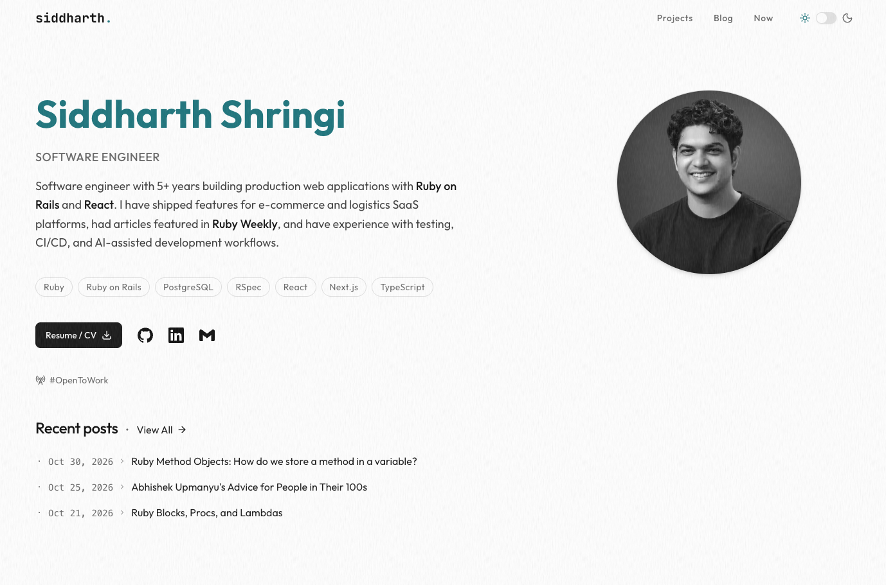

# Siddharth's Portfolio

My personal portfolio website showcasing my professional experience, projects, and technical writing.

**Website:** [siddharthshringi.com](https://siddharthshringi.com/)

## Preview



## Features

- **Dark and Light Themes:** Switch between dark and light themes.
- **Technical Blog:** Read technical articles with syntax highlighting and reading-time information.

## Tech Stack

- **Framework:** Next.js 15
- **Language:** TypeScript
- **UI Library:** React 19
- **Styling:** Tailwind CSS 4
- **UI Components:** Radix UI
- **Icons:** Lucide React
- **Animations:** Motion
- **Content:** MDX
- **Syntax Highlighting:** Shiki and Rehype Pretty Code
- **Theme Management:** next-themes

## Getting Started

### Prerequisites

- Node.js
- npm

### Installation

Clone the repository:

```bash
git clone https://github.com/SiddharthShringi/siddharth-portfolio.git
```

Navigate to the project directory:

```bash
cd siddharth-portfolio
```

Install dependencies:

```bash
npm install
```

Start the development server:

```bash
npm run dev
```

Open [http://localhost:3000](http://localhost:3000) in your browser.

---

This repository contains the source code for my personal portfolio website. It is shared publicly to showcase my work and development practices.
